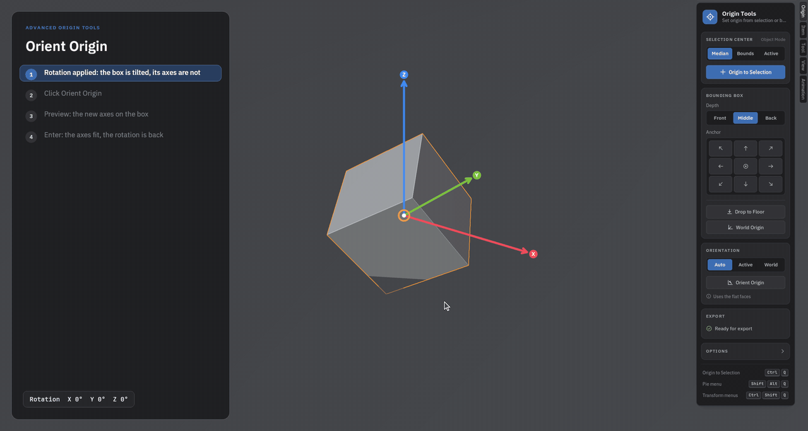
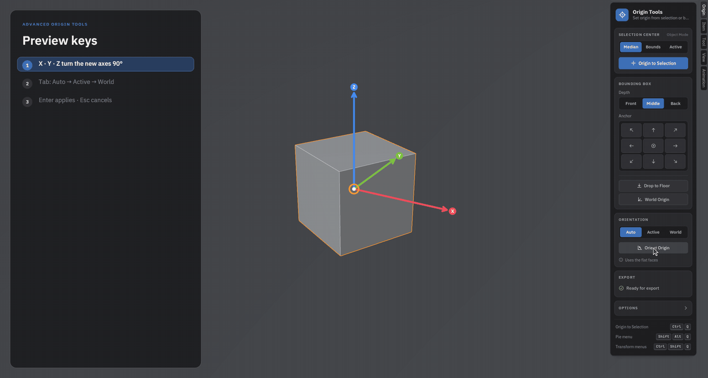
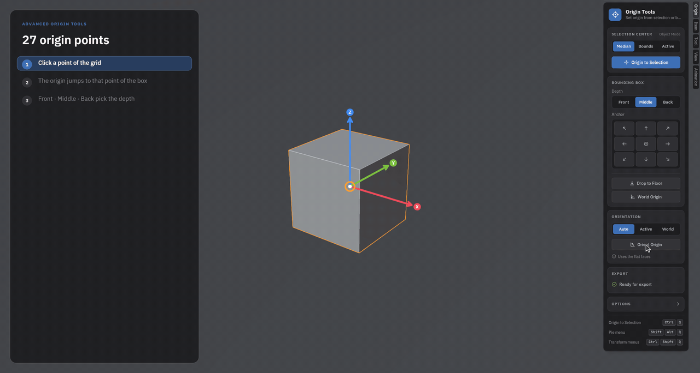
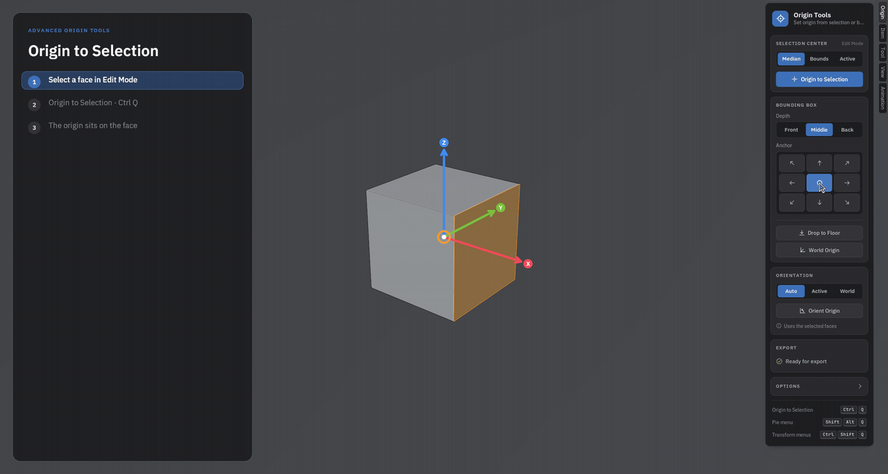
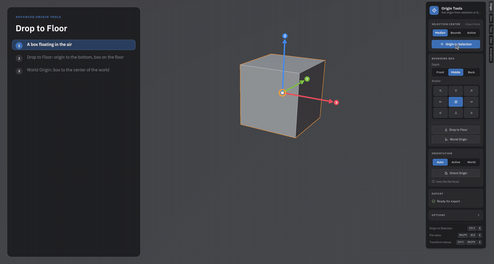
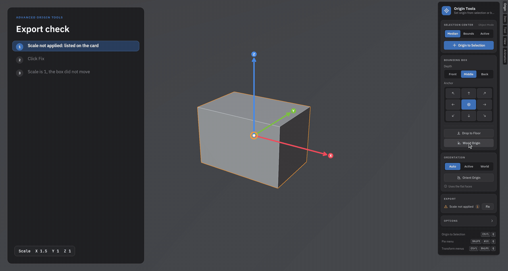
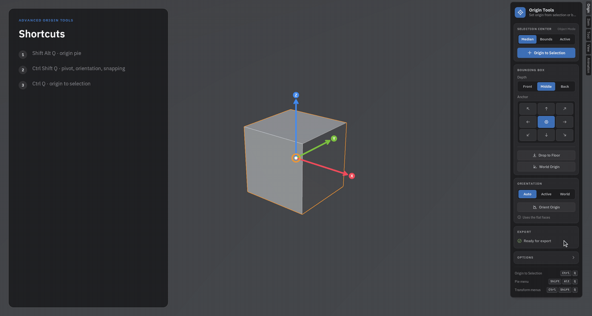

# Advanced Origin Tools

A free Blender add-on for everything about an object's origin: put it on the selection or on any point of
the bounding box, get an object's axes back after its rotation was applied, and check objects before
they go to a game engine.

Made by **Moss3D**.

**Download (free):** [GitHub Releases](https://github.com/3dsmoss/advanced-origin-tools/releases/latest) ·
[Gumroad](https://moss3d.gumroad.com/l/origin-tools)

▶ [Watch the 1-minute video on YouTube](https://www.youtube.com/watch?v=vPk3yA4KC8A)

## Features

### Orient Origin: get the axes back

You rotated an object and applied the rotation by mistake (or it came in tilted from an FBX). The mesh
is still tilted, but its axes now point along the world, and the rotation reads 0, 0, 0. Moving it
along its own axis or putting the origin on a corner no longer works.

**Orient Origin** reads the object's shape and lays its axes back onto it. The mesh does not move; only
the axes turn, and the rotation values come back.

1. Press **Orient Origin** on the card (or in the pie menu).
2. A preview shows the new axes on the object as X / Y / Z arrows.
3. If an axis landed on the wrong side, press **X**, **Y** or **Z** to turn the axes a quarter turn.
4. **Enter** applies, **Esc** cancels.

Modes:
- **Auto** – Object Mode: the object's own flat faces. Edit Mode: the selected faces, edges or vertices.
- **Active** – copy the axes of the active object (select the others first, the source last).
- **World** – straighten the axes to the world; the mesh stays where it is.

More in the Adjust Last Operation panel (F9): View, 3D Cursor, which axis follows the face normal, and
which axis runs along the longest side.

### Origin to selection and bounding box

- **Origin to Selection** – median, bounds or active element of the Edit Mode selection (also from
  Object Mode, using the stored selection).

  

- **27 bounding box points** – a 3 × 3 grid plus Front / Middle / Back.
- **Drop to Floor** – the origin goes to the bottom center and the object rests on Z = 0.
- **World Origin** – the object moves so its new origin sits at the world origin.

  

- Works on several objects at once (each its own origin, or one shared origin), in local or world space,
  with or without modifiers.
- Keeps children, linked duplicates, shape keys and location keyframes in place, and keeps Mirror
  modifier objects on their mirror plane.

### Export check

Before a model goes to Unreal or Unity, the card checks the selected meshes for:
- scale not applied,
- negative (mirrored) scale – faces come out inside out in most engines,
- an origin far away from the mesh.

Each problem has a **Fix** button.

## Shortcuts

| Keys | Over the 3D View |
|---|---|
| **Ctrl Q** | Origin to Selection |
| **Shift Alt Q** | Origin pie menu |
| **Ctrl Shift Q** (or Shift Mouse 4) | Transform Orientation, Pivot Point and Snapping around the cursor |

> **Note:** in Blender, Ctrl Q normally quits. With this add-on, Ctrl Q never closes Blender: over the
> 3D View it sets the origin, elsewhere it does nothing. Quit with File > Quit. All shortcuts can be
> changed or switched off in the add-on preferences.

## Installation

Blender **4.2 or newer** (tested on 4.3, 4.5 and 5.2).

1. Download `advanced_origin_tools-x.y.z.zip` from
   [Releases](https://github.com/3dsmoss/advanced-origin-tools/releases/latest) or
   [Gumroad](https://moss3d.gumroad.com/l/origin-tools). Don't unzip it.
2. In Blender: **Edit > Preferences > Get Extensions**, then the **⌄** menu at the top right >
   **Install from Disk…**, and pick the zip.
3. Open the sidebar in the 3D View (**N**) and the **Origin** tab.

The card style can be switched to Blender's classic panel in the add-on preferences.

## Limits

- On a shape that looks the same from several sides (a cube turned more than 45°), Auto finds the right
  faces but cannot know which side used to be the front: two axes may swap. The preview shows it, and
  X / Y / Z fixes it in one key.
- Organic shapes (a head, a rock) have no clear direction: select a face in Edit Mode and use Auto there.

## License

The add-on is free software under the **GNU General Public License v3.0 or later** (see `LICENSE`).
The bundled fonts, IBM Plex Sans and JetBrains Mono, are under the SIL Open Font License 1.1
(`advanced_origin_tools/fonts/`).

## Moss3D

- Discord: https://discord.gg/tZGkZs2eRh
- Also by Moss3D: **[TexBridge](https://moss3d.gumroad.com/l/texbridge)** – Substance Painter to Unreal Engine.
